<div align="center">


**Uma loja virtual desenvolvida para um negócio real.** 🍯


</div>

---

## 🍯 Sobre o projeto

**Lila's – Pão de Mel** é uma aplicação web criada como projeto da disciplina **Desenvolvimento Web 1**, na **Universidade Tecnológica Federal do Paraná (UTFPR)**, em 2026.

A proposta nasceu de uma necessidade real: ajudar uma empreendedora a organizar a venda de pães de mel, reunindo em um único sistema o catálogo, os pedidos, o atendimento e a administração do negócio.

O desenvolvimento envolveu compreender as necessidades da usuária, definir regras de negócio e transformá-las em funcionalidades. Assim, o projeto aproxima o aprendizado de programação das etapas de análise e construção de software para um cliente real.

## ✨ Funcionalidades

<table>
<tr>
<td width="50%" valign="top">

### 🛍️ Área do cliente

- Catálogo de produtos, fotos e sabores
- Seleção de quantidades e carrinho de compras
- Checkout com entrega ou retirada
- Cálculo de frete por localidade
- Aplicação de cupons e descontos
- Pagamento por Pix e envio opcional de comprovante
- Consulta de pedidos e seus status
- Cadastro, login e recuperação de senha

</td>
<td width="50%" valign="top">

### 🍫 Área administrativa

- Gerenciamento de usuários e permissões
- CRUD de produtos, categorias e sabores
- Estoque por produto e sabor
- Gerenciamento de pedidos e pagamentos
- Cadastro de fretes e cupons
- Banners e mensagens promocionais
- Bloqueios da agenda de produção e entrega
- Acompanhamento financeiro e relatórios

</td>
</tr>
</table>

## 🧩 Regras de negócio

<details>
<summary><strong>📅 Produção, estoque e agendamento</strong></summary>

- Não são permitidas entregas ou retiradas no mesmo dia do pedido.
- Pedidos de até 20 unidades de pão de mel grande podem ser agendados para o dia seguinte, desde que haja estoque pronto e disponibilidade na agenda.
- Pedidos acima de 20 unidades exigem antecedência de 7 dias.
- Pães de mel mini são produzidos sob encomenda e exigem antecedência de 7 dias.
- A administração pode bloquear datas para produção, entregas/retiradas ou ambos.

</details>

<details>
<summary><strong>💳 Pagamento, descontos e pedidos</strong></summary>

- O pagamento é realizado por Pix.
- A confirmação do recebimento é feita pela administração após conferência do pagamento.
- Há desconto automático de 5% para pedidos com mais de 100 unidades, conforme as regras do sistema.
- Quando um cupom e o desconto automático forem aplicáveis, prevalece o maior benefício, sem acumulação.
- Pedidos cancelados podem exigir acompanhamento de reembolso.

</details>

<details>
<summary><strong>🔐 Perfis de acesso</strong></summary>

- **Cliente:** acesso à loja e às próprias compras.
- **Administrador:** acesso ao painel de gerenciamento.
- **Ambos:** possibilidade de alternar entre a loja e a administração.

</details>

## 🗄️ Banco de dados

O banco de dados foi desenvolvido utilizando PostgreSQL,
contemplando os relacionamentos exigidos na disciplina
de Desenvolvimento Web 1.

### Estrutura do banco de dados

<p align="center">
  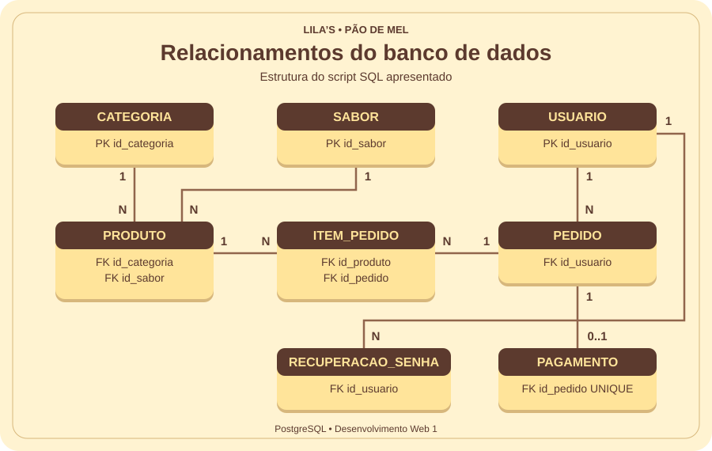
</p>

### Relacionamentos

<p align="center">
  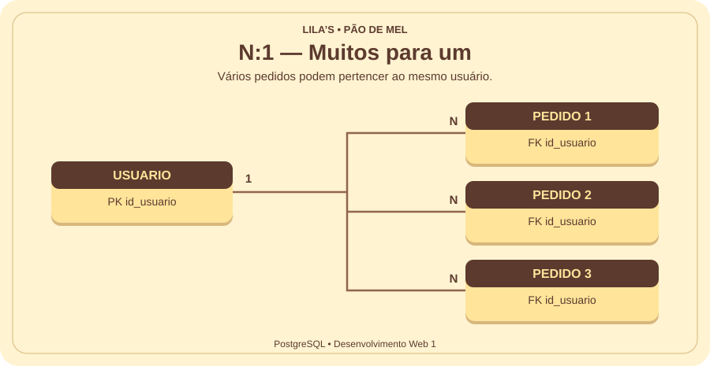
  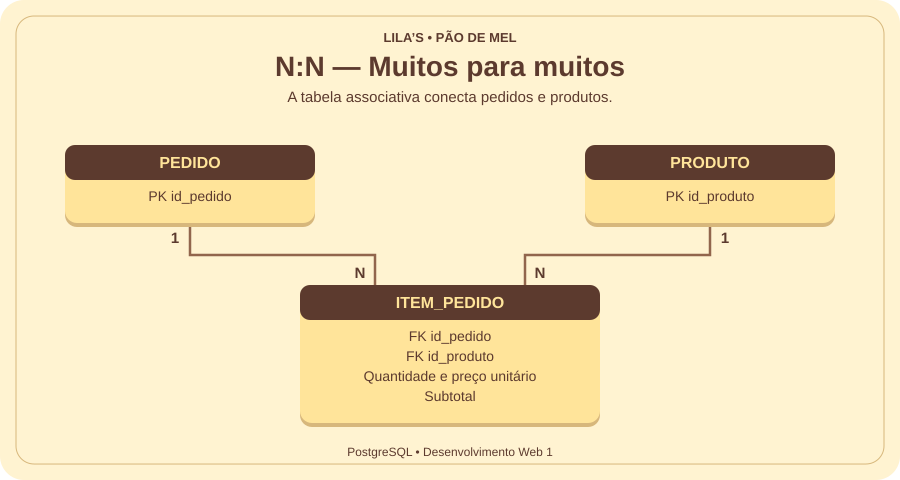
</p>

<p align="center">
  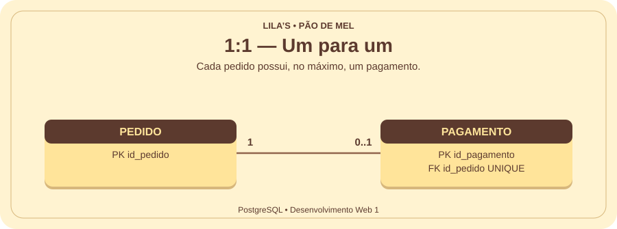
  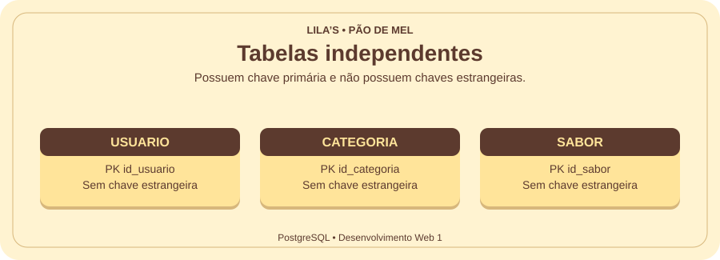
</p>

### Requisitos atendidos

<p align="center">
  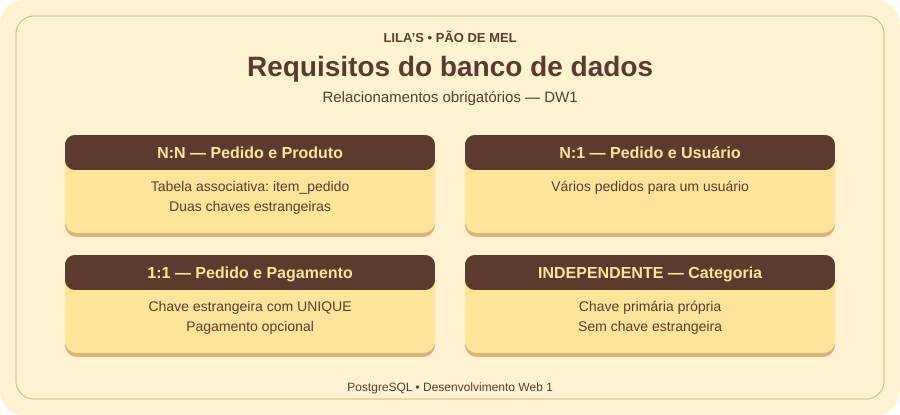
</p>


<!-- ======================================== -->
<!--        GALERIA DO PROJETO LILA'S        -->
<!-- ======================================== -->

<h2 align="center">📸 Galeria do Projeto</h2>

<p align="center">
  Conheça as principais telas da <b>Lila's – Pão de Mel</b>,
  acompanhando a jornada do cliente e o gerenciamento da loja.
</p>

<br>

<h3 align="center">🍯 Experiência do Cliente</h3>

<p align="center">
  Da escolha dos produtos à finalização do pedido.
</p>

<br>

<h4 align="center">01 • Página Inicial</h4>
<p align="center">
  Apresentação da loja, banners e catálogo de produtos.
</p>
<p align="center">
  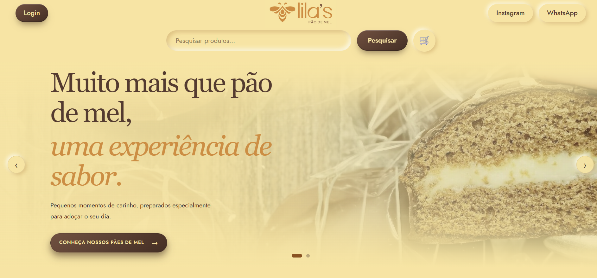
</p>

<br>

<h4 align="center">02 • Detalhes do Produto</h4>
<p align="center">
  Visualização do produto, escolha do sabor e quantidade.
</p>
<p align="center">
  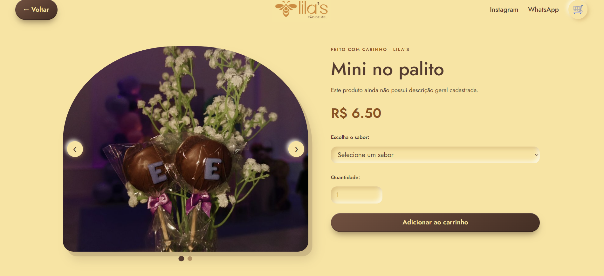
</p>

<br>

<h4 align="center">03 • Carrinho de Compras</h4>
<p align="center">
  Organização dos itens, quantidades e valores do pedido.
</p>
<p align="center">
  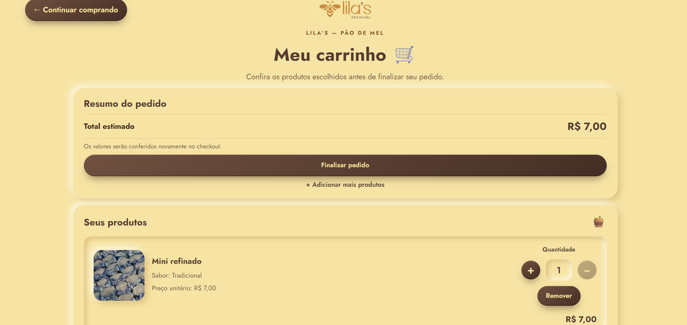
</p>

<br>

<h4 align="center">04 • Login</h4>
<p align="center">
  Autenticação para acessar as funcionalidades da loja.
</p>
<p align="center">
  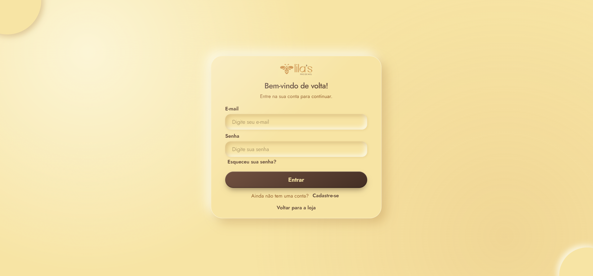
</p>

<br>

<details>
  <summary><b>🔐 Recuperação de Senha</b></summary>
  <br>
  <p align="center">
    Recurso para recuperar o acesso à conta.
  </p>
  <p align="center">
    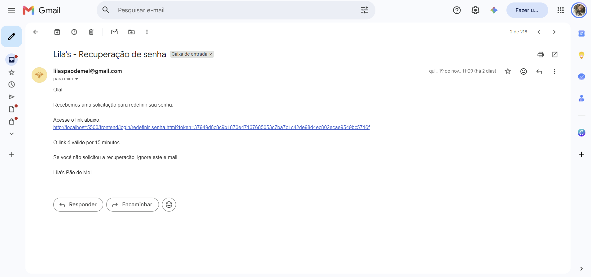
  </p>
</details>

<br>

<h4 align="center">05 • Checkout</h4>
<p align="center">
  Definição da modalidade, endereço, dados do pedido e cupons.
</p>
<p align="center">
  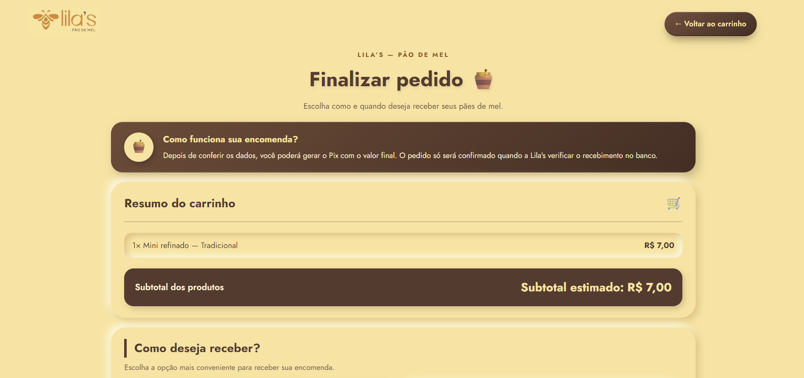
</p>

<br>

<h4 align="center">06 • Pagamento</h4>
<p align="center">
  Finalização do pedido e orientações para pagamento via Pix.
</p>
<p align="center">
  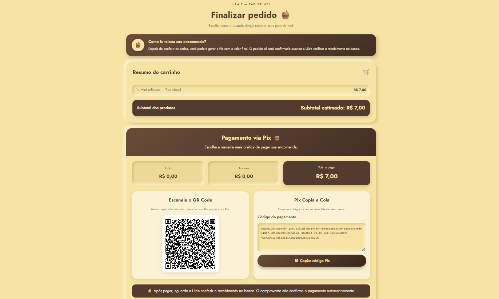
</p>

<br>

---

<h3 align="center">⚙️ Experiência Administrativa</h3>

<p align="center">
  Ferramentas para organizar, administrar e acompanhar a loja.
</p>

<br>

<h4 align="center">07 • Painel Administrativo</h4>
<p align="center">
  Acesso centralizado aos módulos de gerenciamento.
</p>
<p align="center">
  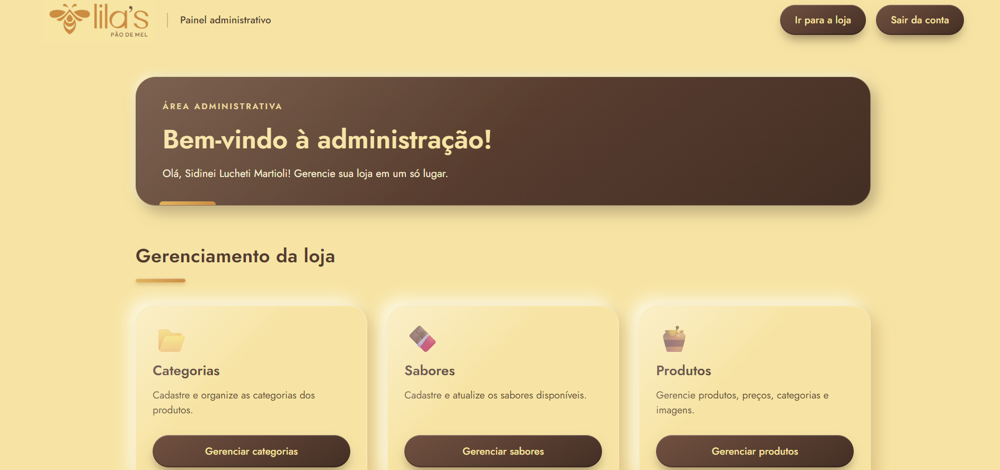
</p>

<br>

<h4 align="center">08 • Relatórios</h4>
<p align="center">
  Visualização de indicadores e resultados da loja.
</p>
<p align="center">
  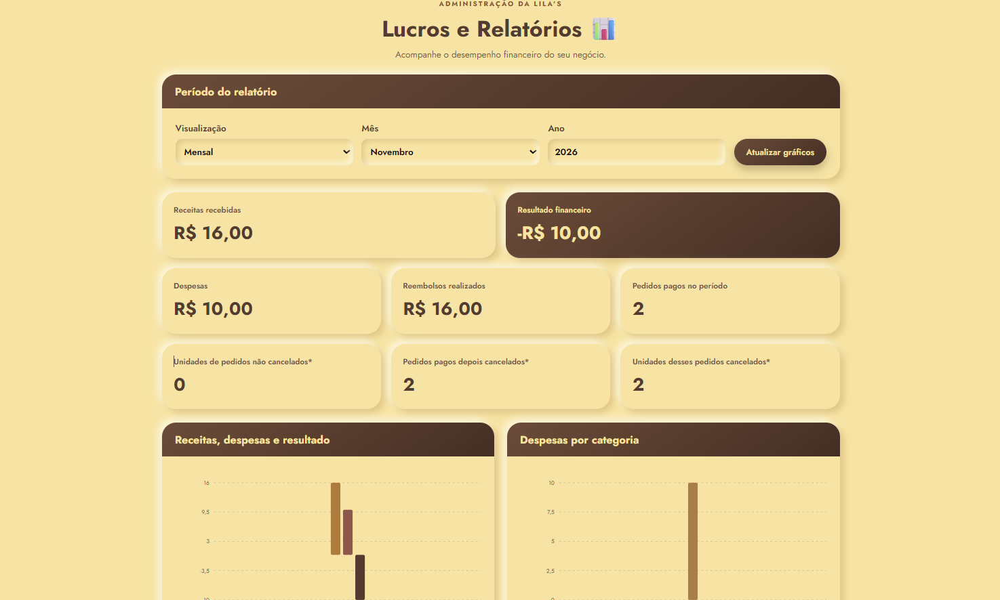
</p>

<h4 align="center">09 • Agenda</h4>
<p align="center">
  Organizador de dias disponíveis para entrega e retirada.
</p>
<p align="center">
  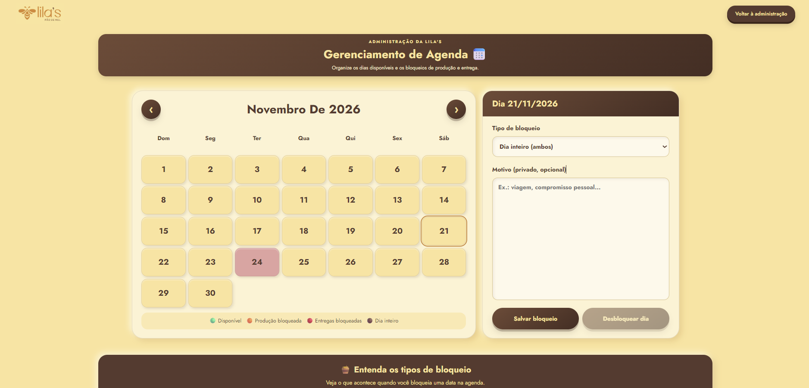
</p>

<br>

<p align="center">
  <i>🍯 Lila's – Pão de Mel | Do pedido à gestão, tudo em um só lugar.</i>
</p>

<!-- ======================================== -->
<!--             FIM DA GALERIA              -->
<!-- ======================================== -->

## 🛠️ Tecnologias e arquitetura

| Camada | Tecnologias |
|---|---|
| Interface | HTML5, CSS3 e JavaScript |
| Servidor | Node.js e Express |
| Banco de dados | PostgreSQL |
| Autenticação | Sessões, cookies e validação no backend |
| Recuperação de senha | Nodemailer |

O sistema separa as responsabilidades do **frontend** e do **backend**, utilizando rotas, controladores e serviços para organizar a lógica da aplicação.

## 🚀 Como executar localmente

<details>
<summary><strong>Ver instruções de instalação</strong></summary>

### Pré-requisitos

- Node.js e npm
- PostgreSQL
- Um editor de código, como o VS Code

### 1. Clonar o repositório

```bash
git clone URL_DO_SEU_REPOSITORIO
cd NOME_DO_REPOSITORIO
```

### 2. Instalar as dependências do backend

```bash
cd backend
npm install
```

### 3. Preparar o banco de dados

Crie um banco PostgreSQL e execute os scripts SQL disponibilizados no repositório, seguindo a ordem indicada neles.

### 4. Configurar as variáveis de ambiente

Crie um arquivo `.env` na raiz do projeto, com os dados do seu ambiente local:

```env
DB_HOST=localhost
DB_PORT=5432
DB_NAME=trabalho-dw1-4bimestre
DB_USER=postgres
DB_PASSWORD=sua_senha
PORT=3001

JWT_SECRET=coloque_uma_Senha_longa_e_secreta

EMAIL_USUARIO=seu_usuario@gmail.com
EMAIL_SENHA=senha_gerada_pelo_google
URL_FRONTEND=http://localhost:5500

# PIX REAL
PIX_CHAVE=sua_chave
PIX_NOME=nome_do_pix
PIX_CIDADE=cidade_que_você_mora
```

> **Segurança:** não publique seu arquivo `.env` com senhas reais. Inclua `.env` no `.gitignore` e, se desejar, disponibilize um `.env.example` sem credenciais.

### 5. Iniciar o servidor

```bash
node server.js
```

Por padrão, o backend do projeto utiliza a porta **3001**.

### 6. Abrir o frontend

Abra a página inicial do frontend usando um servidor local, como a extensão **Live Server** do VS Code (comumente na porta **5500**).

> **Importante:** confira os caminhos dos scripts SQL, a configuração das variáveis de ambiente e o arquivo de entrada do frontend antes de publicar estas instruções como definitivas.

</details>

## 🔒 Segurança

O projeto contempla autenticação com cookies, verificação de sessão, autorização por perfil e validação de dados no servidor. Informações sensíveis, como senhas e credenciais, não devem ser incluídas no repositório público.

## 🎓 Contexto acadêmico

- **Instituição:** Universidade Tecnológica Federal do Paraná (UTFPR)
- **Disciplina:** Desenvolvimento Web 1
- **Período:** 4º bimestre de 2026
- **Projeto:** Aplicação web para gerenciamento de uma loja de pães de mel
- **Desenvolvimento:** Maria Eduarda Brito Lucheti Martioli

Este projeto representa a aplicação prática de conceitos de desenvolvimento web, banco de dados, autenticação, interfaces e levantamento de requisitos em uma solução pensada para uma necessidade real.

---

<div align="center">

**Feito com dedicação, aprendizado e um toque de mel. 🍯🤎**


</div>
